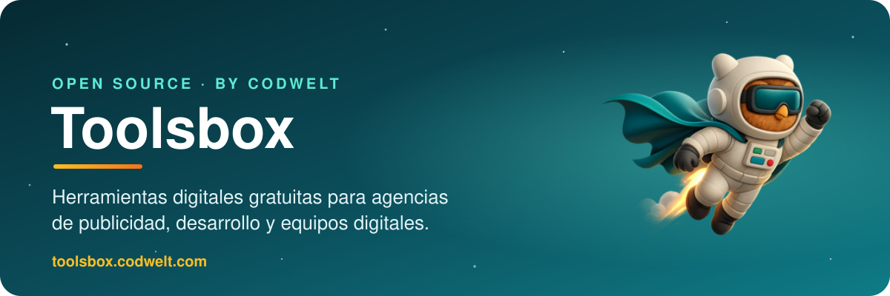
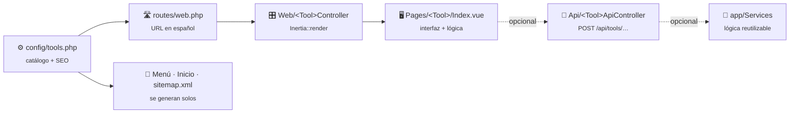
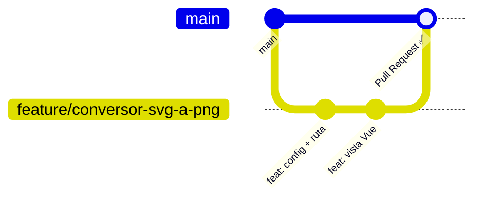

<a href="https://toolsbox.codwelt.com">
  
</a>

<p align="center">
  <a href="https://codwelt.com/toolsbox-herramientas-digitales-gratis/"></a>
  <a href="https://toolsbox.codwelt.com"></a>
  <a href="https://codwelt.com/"></a>
  <a href="https://opensource.org/licenses/MIT"></a>
</p>

<p align="center">
  
  
  
  
  
  
  
</p>

<p align="center">
  <a href="#-qué-es-toolsbox"><b>Qué es</b></a> ·
  <a href="#-herramientas-disponibles"><b>Herramientas</b></a> ·
  <a href="#-instalación-local"><b>Instalación</b></a> ·
  <a href="#-cómo-funciona-por-dentro"><b>Arquitectura</b></a> ·
  <a href="#-cómo-contribuir"><b>Contribuir</b></a> ·
  <a href="#-agregar-una-herramienta-nueva"><b>Nueva herramienta</b></a>
</p>

<br>

## 🚀 ¿Qué es Toolsbox?


**Toolsbox** es una iniciativa de **[Codwelt](https://codwelt.com/)** para reunir en un solo lugar **todas las herramientas que una agencia de publicidad, una agencia de desarrollo o cualquier profesional digital necesita en su día a día**: optimizar imágenes, formatear código, analizar SEO, generar códigos QR, crear paletas de colores y mucho más.

La idea es que **toda la comunidad de desarrolladores** pueda sumar sus propias herramientas, mejorar las existentes y mantener este proyecto vivo. Si alguna vez programaste un script útil para tu trabajo, **¡este es el lugar para compartirlo!**

> [!NOTE]
> Conoce más del proyecto en su landing: **[https://codwelt.com/toolsbox-herramientas-digitales-gratis/](https://codwelt.com/toolsbox-herramientas-digitales-gratis/)**
>
> Este proyecto es desarrollado y mantenido por **[Codwelt — https://codwelt.com/](https://codwelt.com/)**, con el aporte de la comunidad.

<br clear="right">

## 🧰 Herramientas disponibles

<table>
  <tr>
    <td width="33%" valign="top">
      <h3>🖼️ Imágenes</h3>
      <ul>
        <li>Comprimir imágenes</li>
        <li>Quitar fondo</li>
        <li>Redimensionar</li>
        <li>Convertidor universal (WebP ⇄ PNG…)</li>
        <li>Marca de agua</li>
        <li>Generador de QR</li>
        <li>Generador de códigos de barras</li>
        <li>Generador de favicons</li>
      </ul>
    </td>
    <td width="33%" valign="top">
      <h3>💻 Desarrollo</h3>
      <ul>
        <li>HTML a texto</li>
        <li>Codificar / decodificar Base64</li>
        <li>Imagen a Base64</li>
        <li>Formateador HTML</li>
        <li>Formateador CSS</li>
        <li>Formateador XML</li>
        <li>Formateador JSON</li>
        <li>Formateador JavaScript</li>
        <li>JSON a array</li>
      </ul>
    </td>
    <td width="33%" valign="top">
      <h3>✍️ Texto</h3>
      <ul>
        <li>Contador de palabras</li>
        <li>Generador Lorem Ipsum</li>
        <li>Analizador de texto</li>
        <li>Corrector ortográfico</li>
        <li>Detector de webs hechas con IA</li>
      </ul>
    </td>
  </tr>
  <tr>
    <td valign="top">
      <h3>📈 SEO</h3>
      <ul>
        <li>Analizador SEO de URL</li>
        <li>Estructura de títulos (H1–H6)</li>
      </ul>
    </td>
    <td valign="top">
      <h3>🎨 Colores</h3>
      <ul>
        <li>Paleta de colores</li>
      </ul>
    </td>
    <td valign="top">
      <h3>🛠️ Utilidades</h3>
      <ul>
        <li>Biblioteca de países</li>
        <li>Biblioteca de emojis</li>
        <li>Links de WhatsApp</li>
        <li>¿Cuál es mi IP pública?</li>
      </ul>
    </td>
  </tr>
</table>

<sub>📌 La lista oficial y actualizada vive en <a href="config/tools.php"><code>config/tools.php</code></a>.</sub>

## 📦 Instalación local

### Requisitos

| | Requisito | Notas |
|:-:|---|---|
| 🐘 | **PHP 8.2+** | Con la extensión **Imagick** (quitar fondo y favicons) |
| 🎼 | **Composer** | [getcomposer.org](https://getcomposer.org) |
| 🟢 | **Node.js 20.19+ o 22.12+** y npm | Para compilar el frontend con Vite |
| 🌱 | **Git** | Para clonar y contribuir |

### En 3 comandos

```bash
# 1. Clona el repositorio (o tu fork)
git clone https://github.com/codwelt/toolbox.git && cd toolbox

# 2. Instala dependencias, crea el .env, genera la APP_KEY, migra y compila assets
composer setup

# 3. Levanta el entorno de desarrollo (servidor, colas, logs y Vite a la vez)
composer dev
```

Abre **<http://localhost:8000>** y listo. 🎉

<details>
<summary><b>Prefiero hacerlo paso a paso</b></summary>

```bash
composer install
cp .env.example .env
php artisan key:generate
touch database/database.sqlite
php artisan migrate
npm install
npm run dev          # en una terminal
php artisan serve    # en otra terminal
```

</details>

### Scripts útiles

| Comando | Qué hace |
|---|---|
| `composer dev` | Servidor Laravel + cola + logs (Pail) + Vite en paralelo |
| `composer test` | Ejecuta la suite de pruebas |
| `npm run build` | Compila los assets para producción |
| `npm run build:emoji-library` | Regenera la biblioteca de emojis (`resources/js/emoji`) |
| `npm run generate:countries` | Regenera el listado de países (`resources/js/countries`) |
| `./vendor/bin/pint` | Formatea el código PHP con Laravel Pint |

## 🧩 ¿Cómo funciona por dentro?

Cada herramienta sigue **el mismo patrón**, así que cuando entiendes una, las entiendes todas:



| Pieza | Ubicación | Rol |
|---|---|---|
| ⚙️ Catálogo | [`config/tools.php`](config/tools.php) | Categoría, ruta, slug y SEO (title, description, h1, keywords, FAQ) |
| 🛣️ Ruta | [`routes/web.php`](routes/web.php) | URL pública amigable en español |
| 🎛️ Controlador | `app/Http/Controllers/Web/` | Lee el config y renderiza la página con Inertia |
| 🖥️ Vista | `resources/js/Pages/<Tool>/Index.vue` | Interfaz y lógica (usa `AppLayout`) |
| 🔌 API *(opcional)* | `app/Http/Controllers/Api/` | Procesamiento en el servidor cuando es imprescindible |
| 🧠 Servicios *(opcional)* | `app/Services/` | Lógica de negocio reutilizable |

> [!TIP]
> **`config/tools.php` es la fuente de verdad.** El menú (compartido desde [`AppServiceProvider`](app/Providers/AppServiceProvider.php)), la página de inicio y el [`sitemap.xml`](app/Http/Controllers/Web/SitemapController.php) se construyen automáticamente a partir de ese archivo.

- 🔒 **Privacidad primero:** siempre que sea posible, el procesamiento se hace **en el navegador** y no se suben archivos al servidor.
- 🔎 **SEO de serie:** cada herramienta tiene URL en español, `title`, `description`, `canonical`, `keywords` y preguntas frecuentes para datos estructurados.

## 🤝 ¿Cómo contribuir?

<table>
  <tr>
    <td align="center" width="25%">🆕<br><b>Nuevas herramientas</b><br><sub>Propón o crea una</sub></td>
    <td align="center" width="25%">🐛<br><b>Reportar errores</b><br><sub>Abre un <a href="https://github.com/codwelt/toolbox/issues">issue</a></sub></td>
    <td align="center" width="25%">✨<br><b>Mejoras</b><br><sub>UX, rendimiento, accesibilidad</sub></td>
    <td align="center" width="25%">📝<br><b>Documentación</b><br><sub>Haz este README aún mejor</sub></td>
  </tr>
</table>

### Flujo de trabajo con Git



1. **Haz un fork** de [github.com/codwelt/toolbox](https://github.com/codwelt/toolbox).
2. **Crea una rama** descriptiva a partir de `main`:
   ```bash
   git checkout -b feature/conversor-svg-a-png
   # o: fix/formateador-json-unicode, docs/mejora-readme
   ```
3. **Haz commits claros**, por ejemplo:
   ```
   feat: agrega conversor de SVG a PNG
   fix: corrige el conteo de palabras con emojis
   ```
4. **Verifica** que todo funcione: `composer test` y `npm run build`.
5. **Abre un Pull Request** hacia `main` explicando qué hace el cambio, por qué es útil, cómo probarlo y capturas si hay cambios visuales.

El equipo de [Codwelt](https://codwelt.com/) revisará tu PR y te dará retroalimentación lo antes posible. 💬

## 🧪 Agregar una herramienta nueva

Ejemplo: un **“Conversor de SVG a PNG”**.

<details open>
<summary><b>1️⃣ Regístrala en <code>config/tools.php</code></b></summary>

Dentro de la categoría que corresponda:

```php
'svg_to_png' => [
    'route' => 'tools.svg-to-png',
    'slug' => 'convertir-svg-a-png-online',
    'path' => '/convertir-svg-a-png-online',
    'title' => 'Convertir SVG a PNG online gratis | Toolsbox Codwelt',
    'description' => 'Convierte tus archivos SVG a PNG en segundos, directamente en tu navegador.',
    'h1' => '🖼️ Convertir SVG a PNG online',
    'keywords' => ['svg a png', 'convertir svg', 'svg to png'],
    'canonical' => 'https://toolsbox.codwelt.com/convertir-svg-a-png-online',
    'faq' => [
        ['question' => '¿Mis archivos se suben al servidor?', 'answer' => 'No, la conversión se hace en tu navegador.'],
    ],
],
```

</details>

<details open>
<summary><b>2️⃣ Crea el controlador</b></summary>

`app/Http/Controllers/Web/SvgToPngController.php` (puedes copiar [`WordCounterController`](app/Http/Controllers/Web/WordCounterController.php) como base):

```php
public function index(Request $request)
{
    $tool = config('tools.categories.images.items.svg_to_png');

    return Inertia::render('SvgToPng/Index', [
        'seo' => [
            'title' => $tool['title'],
            'description' => $tool['description'],
            'canonical' => $tool['canonical'],
            'keywords' => $tool['keywords'],
            'h1' => $tool['h1'],
            'faq' => $tool['faq'],
            'url' => $tool['canonical'],
        ],
    ]);
}
```

</details>

<details open>
<summary><b>3️⃣ Agrega la ruta</b></summary>

En [`routes/web.php`](routes/web.php), antes del `Route::fallback`:

```php
Route::get('/convertir-svg-a-png-online', [SvgToPngController::class, 'index'])->name('tools.svg-to-png');
```

</details>

<details open>
<summary><b>4️⃣ Crea la vista</b></summary>

`resources/js/Pages/SvgToPng/Index.vue`, usando `AppLayout` y la prop `seo`. Toma como referencia cualquier página existente, por ejemplo [`WordCounter/Index.vue`](resources/js/Pages/WordCounter/Index.vue).

</details>

<details>
<summary><b>5️⃣ (Opcional) Endpoint en el servidor</b></summary>

Si necesitas procesar en el servidor, crea `app/Http/Controllers/Api/SvgToPngApiController.php` y su ruta `POST /api/tools/svg-to-png`. Valida siempre la entrada (tipo y tamaño de archivo) y no guardes archivos de los usuarios más tiempo del necesario.

</details>

> [!IMPORTANT]
> ¡Listo! La herramienta aparecerá **automáticamente** en el menú, en la página de inicio y en el sitemap.

### ✅ Buenas prácticas

- [x] Interfaz en **español** y coherente con el resto (Bootstrap 5 + `AppLayout`).
- [x] Procesamiento **del lado del cliente** siempre que sea posible.
- [x] Nunca subas credenciales ni el `.env`; documenta las variables nuevas en `.env.example`.
- [x] Ejecuta `./vendor/bin/pint` antes de hacer commit.
- [x] **Una herramienta por Pull Request** para facilitar la revisión.

## 🔐 Seguridad

> [!CAUTION]
> Si encuentras una vulnerabilidad, por favor **no abras un issue público**. Contáctanos a través de [codwelt.com](https://codwelt.com/) para solucionarla de forma responsable.

## 📄 Licencia

Distribuido bajo la licencia [MIT](https://opensource.org/licenses/MIT).

<br>

<p align="center">
  <a href="https://codwelt.com/"></a>
</p>

<p align="center">
  Hecho con ❤️ por <a href="https://codwelt.com/"><b>Codwelt</b></a> y la comunidad de desarrolladores<br>
  <a href="https://codwelt.com/">https://codwelt.com/</a> · <a href="https://toolsbox.codwelt.com">toolsbox.codwelt.com</a>
</p>
